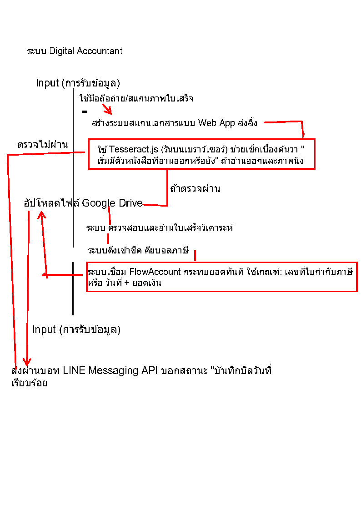
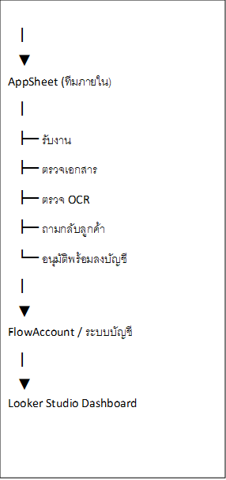
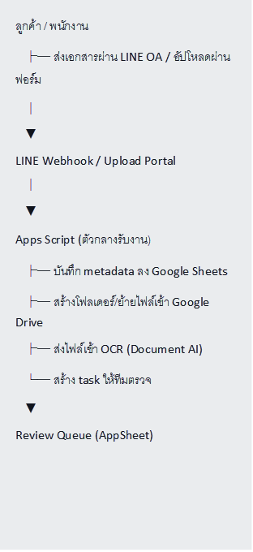

> ต้นฉบับ: ไฟล์ .docx ที่ Phong อัปโหลด 27.10.2026 แปลงเป็น Markdown โดยไม่แก้เนื้อหา ใช้เป็นเอกสารอ้างอิงความต้องการ ไม่ใช่สเปกเครื่องมือ (ดู automation-plan-review.md)

**แผนออกแบบระบบ Automation สำหรับสำนักงานบัญชี**

**แผนที่ 1**

สำนักงานบัญชีเป็นธุรกิจที่ต้องดำเนินงานภายใต้กรอบเวลาและความถูกต้องสูง
โดยเฉพาะในช่วงปิดงบประจำปี ช่วงยื่นภาษีรายเดือน
และช่วงที่ลูกค้าส่งเอกสารพร้อมกันจำนวนมาก ทำให้ทีมงานต้องรับภาระงานซ้ำ ๆ
ที่ใช้เวลาเยอะและมีโอกาสเกิดความผิดพลาดได้ง่าย เช่น การคัดแยกเอกสาร การคีย์ข้อมูล
การกระทบยอดธนาคาร การติดตามเอกสาร และการจัดทำรายงานสรุป

จากลักษณะงานดังกล่าว พบว่างานจำนวนมากเป็นงานที่มีรูปแบบซ้ำเดิม มีกฎเกณฑ์ชัดเจน
และสามารถกำหนดขั้นตอนการทำงานได้
จึงเหมาะอย่างยิ่งต่อการนำระบบอัตโนมัติเข้ามาช่วยลดภาระงาน เพิ่มความรวดเร็ว ลดข้อผิดพลาด
และทำให้บุคลากรสามารถใช้เวลาไปกับงานวิเคราะห์ งานตรวจสอบ
และงานให้คำปรึกษาที่มีมูลค่าสูงกว่าเดิมได้

2\. วัตถุประสงค์ของโครงการ เพื่อลดงานซ้ำ ๆ ที่ใช้เวลามากในสำนักงานบัญชี
เพื่อเพิ่มความถูกต้องในการบันทึกข้อมูลและการกระทบยอด
เพื่อให้การติดตามเอกสารและการสื่อสารกับลูกค้ามีประสิทธิภาพมากขึ้น
เพื่อให้ผู้บริหารสามารถเข้าถึงรายงานและข้อมูลสำคัญได้รวดเร็ว
เพื่อยกระดับสำนักงานบัญชีจากการทำงานแบบใช้แรงคนจำนวนมาก
ไปสู่การทำงานแบบมีระบบและตรวจสอบย้อนหลังได้

3\. ภาพรวมปัญหาของงานสำนักงานบัญชีในปัจจุบัน จากการวิเคราะห์กระบวนการทำงาน
พบปัญหาหลักดังนี้

3.1 ภาระงานกระจุกตัวตามรอบเวลา สำนักงานบัญชีมีช่วงเวลาที่งานหนาแน่นเป็นพิเศษ เช่น
ช่วงปิดงบการเงินประจำปี การยื่นภาษีเงินได้นิติบุคคล และรอบยื่นภาษีประจำเดือน
หากลูกค้าส่งเอกสารล่าช้า จะทำให้ทีมงานต้องเร่งคีย์ข้อมูลและตรวจเอกสารในเวลาจำกัด
ส่งผลให้เกิดความกดดันสูงและเสี่ยงต่อความผิดพลาด

3.2 งานเอกสารใช้เวลามาก ก่อนเริ่มลงบัญชีจริง ทีมงานต้องคัดแยกเอกสาร
ตรวจสอบความสมบูรณ์ เรียงตามวันที่ และจัดเก็บอย่างเป็นระบบ ซึ่งเป็นงานพื้นฐานที่ใช้เวลามาก
แม้จะไม่ได้สร้างมูลค่าโดยตรง แต่จำเป็นต้องทำเพื่อให้การลงบัญชีถูกต้อง

3.3 งานคีย์ข้อมูลและกระทบยอดมีความซ้ำซาก การอ่านใบกำกับภาษี ใบเสร็จ และข้อมูลจาก
Statement เพื่อคีย์ลงระบบทีละรายการ เป็นงานที่ต้องใช้สมาธิและความละเอียดสูง
อีกทั้งการกระทบยอดธนาคารยังต้องตรวจรายการไม่ตรงจำนวนมาก
ซึ่งใช้เวลามากและไม่ควรพึ่งแรงงานคนเพียงอย่างเดียว

3.4 การติดตามเอกสารจากลูกค้าเป็นคอขวดสำคัญ ลูกค้ามักส่งเอกสารไม่ครบ ส่งช้า
หรือไม่สามารถอธิบายที่มาของรายการได้ทันที ทำให้สำนักงานบัญชีต้องเสียเวลาโทรตาม แชตตาม
และสอบถามซ้ำหลายครั้ง ส่งผลต่อความล่าช้าของทั้งระบบ

3.5 การทำรายงานยังพึ่งงานมือ การดึงข้อมูลจากหลายไฟล์มารวมกันเพื่อทำ Pivot Table
หรือรายงานสรุปให้ผู้บริหาร เป็นงานที่ใช้เวลามาก และข้อมูลมักไม่เป็นปัจจุบันแบบทันที

4\. แนวคิดการออกแบบระบบ Automation แนวคิดหลักของโครงการนี้คือการเปลี่ยนงานที่เป็น
Repetitive และ Rule-based - ให้เป็นระบบอัตโนมัติ
โดยยังคงให้เจ้าหน้าที่บัญชีทำหน้าที่ตรวจสอบ วิเคราะห์
และตัดสินใจในรายการที่ซับซ้อนหรือผิดปกติแทน หลักการออกแบบระบบประกอบด้วย
ให้ระบบรับเอกสารและตรวจสอบเบื้องต้นแทนการรับแบบกระจัดกระจาย
ให้ระบบดึงข้อมูลจากเอกสารแทนการคีย์มือ ให้ระบบจับคู่รายการทางบัญชีกับ Statement อัตโนมัติ
ให้ระบบแจ้งเตือนลูกค้าและติดตามเอกสารตามรอบเวลา
ให้ระบบรวมข้อมูลและสร้างรายงานแบบอัปเดตอัตโนมัติ ให้เจ้าหน้าที่ทำงานในบทบาท
“ผู้ตรวจสอบและผู้ควบคุมคุณภาพ” มากกว่าผู้คีย์ข้อมูล

5\. ขอบเขตงานที่เหมาะสมสำหรับการทำ Automation

5.1 ระบบรับเอกสารและคัดแยกเอกสาร ปัจจุบันทีมงานต้องคัดแยกประเภทเอกสาร
ตรวจสอบความสมบูรณ์ และเรียงลำดับเอกสารก่อนลงบัญชี
ซึ่งเป็นงานที่ใช้เวลามากและเกิดซ้ำทุกเดือน แนวทางระบบ จัดทำช่องทางรับเอกสารกลาง เช่น
Portal, Google Drive Form, LINE OA หรือระบบอัปโหลดเอกสาร
ให้ระบบช่วยแยกประเภทเอกสารเบื้องต้น
จัดเก็บเอกสารในโครงสร้างโฟลเดอร์มาตรฐานตามบริษัท / เดือน / ประเภทเอกสาร

\*\*\*ผลลัพธ์ที่คาดหวัง ลดเวลาคัดแยกเอกสาร ลดการหาเอกสารไม่เจอ
เพิ่มความพร้อมของข้อมูลก่อนเริ่มลงบัญชี

5.2 ระบบ OCR สำหรับคีย์ข้อมูลอัตโนมัติ
จากเดิมเจ้าหน้าที่ต้องอ่านใบกำกับภาษีหรือใบเสร็จแล้วคีย์ข้อมูลเองทีละรายการ สามารถใช้ OCR
เพื่อดึงข้อมูล เช่น วันที่ เลขที่เอกสาร ยอดเงิน และ VAT ออกมาเป็นข้อมูลพร้อมใช้งานได้
แนวทางระบบ

ใช้ AI OCR อ่านข้อมูลจากรูปภาพหรือ PDF
สร้างแบบฟอร์มตรวจทานผลลัพธ์ก่อนบันทึกเข้าระบบบัญชี เพิ่มฟังก์ชัน Auto-Categorization
เพื่อช่วยจัดหมวดค่าใช้จ่ายเบื้องต้น เช่น ค่าน้ำมัน ค่าเดินทาง ค่าเช่า ฯลฯ

\*\*\*ผลลัพธ์ที่คาดหวัง ลดเวลาคีย์ข้อมูล 70–80% ในเอกสารที่มีรูปแบบชัดเจน
ลดข้อผิดพลาดจากการพิมพ์มือ ทำให้เจ้าหน้าที่ใช้เวลาไปกับการตรวจสอบแทนการกรอกข้อมูล

5.3 ระบบกระทบยอดธนาคารอัตโนมัติ งานกระทบยอดธนาคารเป็นงานสำคัญที่ใช้เวลามาก
เนื่องจากต้องเทียบ Statement กับสมุดรายวัน และตรวจสอบรายการที่ไม่ตรงกันทีละรายการ
แนวทางระบบ เชื่อมข้อมูลเดินบัญชีจากธนาคารเข้าสู่ระบบแบบอัตโนมัติ ใช้ Auto-Matching
จับคู่รายการโดยดูจากวันที่ จำนวนเงิน และเงื่อนไขที่กำหนด แสดงเฉพาะรายการ Exception
ที่ไม่สามารถจับคู่ได้ ให้เจ้าหน้าที่ตรวจสอบต่อ

\*\*\*ผลลัพธ์ที่คาดหวัง ลดเวลาการกระทบยอด ลดความผิดพลาดของตัวเลข
เพิ่มความเร็วในการปิดบัญชีรายเดือน

5.4 ระบบติดตามเอกสารและแจ้งเตือนลูกค้า
ในปัจจุบันเจ้าหน้าที่ต้องโทรหรือส่งข้อความติดตามลูกค้าเรื่องเอกสารขาด เอกสารหาย
หรือเตือนใกล้วันยื่นภาษี ซึ่งเป็นงานที่เสียเวลามากและไม่ควรใช้แรงคนทำซ้ำทุกเดือน
แนวทางระบบ ตั้งระบบแจ้งเตือนอัตโนมัติผ่าน Email หรือ LINE Bot ตามปฏิทินงาน
ส่งรายการเอกสารที่ต้องส่งประจำเดือนให้ลูกค้าแบบอัตโนมัติ แจ้งสถานะเอกสารว่า “ครบ /
ไม่ครบ / ต้องแก้ไข” ให้ลูกค้าอัปโหลดเอกสารผ่านระบบโดยตรง

\*\*\*ผลลัพธ์ที่คาดหวัง ลดภาระงานติดตามเอกสาร ลดการสื่อสารซ้ำซ้อน
ทำให้ลูกค้ารับรู้สถานะงานชัดเจนขึ้น

5.5 ระบบรายงานและ Dashboard
ปัจจุบันการจัดทำรายงานต้องดึงข้อมูลจากหลายแหล่งและจัดทใหม่ทุกครั้ง
จึงควรออกแบบระบบเชื่อมข้อมูลและแสดงผลแบบ Dashboard เพื่อให้ผู้บริหารเข้าถึงข้อมูลได้ทันที
แนวทางระบบ รวมข้อมูลจากระบบบัญชีและฐานข้อมูลเอกสาร สร้าง Dashboard สำหรับดูรายได้
ค่าใช้จ่าย ภาษี สถานะปิดงบ และสถานะเอกสาร
อัปเดตรายงานอัตโนมัติเมื่อมีข้อมูลใหม่เข้าสู่ระบบ

\*\*\*ผลลัพธ์ที่คาดหวัง ลดเวลาจัดทำรายงาน ช่วยให้ผู้บริหารตัดสินใจได้เร็วขึ้น
เห็นสถานะงานของแต่ละลูกค้าแบบรวมศูนย์

**แผนที่ 2**

1.ขั้นตอนก่อนทำ Automation ลูกค้าส่งเอกสารผ่านแชตหรือกระดาษ เจ้าหน้าที่คัดแยก
ตรวจเอกสาร และเรียงเอกสาร เจ้าหน้าที่คีย์ข้อมูลลงระบบทีละรายการ
เจ้าหน้าที่กระทบยอดธนาคารด้วยมือ เจ้าหน้าที่โทรตามเอกสารที่ขาด
เจ้าหน้าที่รวมข้อมูลทำรายงานปลายเดือน

2.ขั้นตอนหลังทำ Automation ลูกค้าอัปโหลดเอกสารผ่านช่องทางกลาง
ระบบตรวจความครบถ้วนและความชัดเบื้องต้น

OCR ดึงข้อมูลจากเอกสารเข้าแบบฟอร์มรอตรวจ ระบบจัดหมวดรายการเบื้องต้น ระบบเชื่อม
Statement และจับคู่รายการอัตโนมัติ เจ้าหน้าที่ตรวจเฉพาะรายการผิดปกติ
ระบบแจ้งเตือนลูกค้าอัตโนมัติเมื่อเอกสารไม่ครบ Dashboard
อัปเดตสถานะงานและรายงานอัตโนมัติ

3\. บทบาทของบุคลากรหลังมีระบบ Automation

การนำระบบอัตโนมัติเข้ามาใช้ ไม่ได้มีเป้าหมายเพื่อแทนที่บุคลากรทั้งหมด
แต่เพื่อปรับบทบาทของทีมงานให้มีคุณค่ามากขึ้น ดังนี้หรือไม่

1.  จากผู้คีย์ข้อมูล → เป็นผู้ตรวจสอบความถูกต้อง

2.  จากผู้ตามเอกสาร → เป็นผู้ประสานงานกรณีพิเศษ

3.  จากผู้ทำรายงานมือ → เป็นผู้วิเคราะห์และสรุปผล

4.  จากผู้แก้ปัญหาเฉพาะหน้า → เป็นผู้ควบคุมกระบวนการทำงานทั้งระบบ

4\. แผนดำเนินการเป็นระยะ

ระยะที่ 1: จัดระบบรับเอกสารและจัดเก็บเอกสาร เริ่มจากการทำช่องทางรับเอกสารกลาง
โครงสร้างโฟลเดอร์มาตรฐาน และระบบแจ้งสถานะเอกสาร เพื่อแก้ปัญหาพื้นฐานก่อน

ระยะที่ 2: นำ OCR มาใช้กับเอกสารหลัก เริ่มกับเอกสารที่มีรูปแบบชัด เช่น ใบกำกับภาษี
ใบเสร็จรับเงิน และเอกสารค่าใช้จ่ายประจำ

ระยะที่ 3: ทำระบบกระทบยอดอัตโนมัติ เชื่อมข้อมูลธนาคารและออกแบบเงื่อนไข
Auto-Matching เพื่อคัดแยกรายการปกติกับรายการผิดปกติ

ระยะที่ 4: ทำระบบแจ้งเตือนและ Portal ลูกค้า ทำระบบสื่อสารกับลูกค้าแบบอัตโนมัติ
เพื่อลดภาระทีมงานในการตามเอกสาร

ระยะที่ 5: ทำ Dashboard สำหรับผู้บริหาร สรุปสถานะงาน รายรับรายจ่าย ภาษี
และงานค้างของแต่ละลูกค้าในมุมมองเดียว

5\. การควบคุมความเสี่ยงและจุดที่ต้องมีคนตรวจ แม้ระบบ Automation จะช่วยลดงานซ้ำได้มาก
แต่สำนักงานบัญชีจำเป็นต้องกำหนดจุดควบคุมเพื่อรักษาความถูกต้องของข้อมูล ดังนี้

\*\*ข้อมูลจาก OCR ต้องมีการตรวจสอบก่อนบันทึกจริง \*\*รายการที่ระบบจับคู่ไม่ได้
ต้องมีเจ้าหน้าที่ตรวจสอบ

\*\*เอกสารทุกใบต้องสามารถย้อนกลับไปหาไฟล์ต้นฉบับได้
\*\*ระบบต้องมีการกำหนดสิทธิ์ผู้ใช้งานและบันทึกประวัติการแก้ไข

รายการภาษีและงบการเงินยังต้องมีผู้รับผิดชอบตรวจรอบสุดท้ายก่อนยื่นหรือส่งต่อ

6\. การประเมินความคุ้มค่าเบื้องต้น จากข้อมูลเดิม งานที่มีความคุ้มค่าสูงในการทำ Automation
ก่อน ได้แก่ งานคีย์ข้อมูลบิลด้วย OCR และงานกระทบยอดธนาคาร
เนื่องจากช่วยลดเวลาได้มากและลดความผิดพลาดได้ชัดเจน
ขณะที่งานจัดเรียงไฟล์เอกสารและงานรายงานสรุปมีความคุ้มค่าระดับปานกลาง
แต่ยังมีประโยชน์ต่อการควบคุมงานและการบริหารภาพรวมของสำนักงาน

7\. สรุป สำนักงานบัญชีมีลักษณะงานจำนวนมากที่เป็นงานซ้ำ ใช้เวลามาก
และต้องการความละเอียดสูง เช่น การจัดเอกสาร การคีย์ข้อมูล การกระทบยอด
การติดตามเอกสาร และการทำรายงาน ซึ่งเป็นลักษณะงานที่เหมาะสมต่อการนำระบบ
Automation เข้ามาใช้อย่างเป็นขั้นตอน

แผนการออกแบบระบบนี้มีเป้าหมายเพื่อยกระดับสำนักงานบัญชีให้ทำงานได้รวดเร็วขึ้น ถูกต้องขึ้น
ตรวจสอบย้อนหลังได้ง่ายขึ้น และลดการพึ่งพางานมือในกระบวนการที่ไม่จำเป็น
โดยให้บุคลากรเปลี่ยนบทบาทไปสู่งานตรวจสอบ งานวิเคราะห์
และงานให้คำปรึกษาที่สร้างมูลค่าสูงกว่าเดิม ในระยะยาว ระบบ Automation
จะไม่ใช่เพียงเครื่องมือช่วยทำงาน
แต่จะเป็นโครงสร้างพื้นฐานสำคัญที่ทำให้สำนักงานบัญชีสามารถขยายงาน รองรับลูกค้าได้มากขึ้น
และให้บริการได้อย่างเป็นมืออาชีพยิ่งขึ้น

**ความเห็นการเปลี่ยนงานบัญชีให้เป็น Automation**

เป็นแนวการเปลี่ยนงานบัญชีให้เป็น Automation เพราะงานส่วนใหญ่ในแผนกนี้เป็นงานซ้ำ ๆ
(Repetitive) และมีกฎเกณฑ์ชัดเจน (Rule-based) ซึ่งเข้าทางระบบอัตโนมัติพอดี
เพื่อให้เห็นภาพว่าส่วนไหนทำ Automation ได้บ้าง ขอแบ่งงาน "จุกจิก"
ออกเป็นกลุ่มตามเทคโนโลยีที่นำมาใช้

1\. งานคีย์ข้อมูลจากกระดาษลงระบบ (Data Entry)

งานงานบัญชีเดิม นั่งอ่านใบกำกับภาษี/ใบเสร็จ แล้วพิมพ์เลขทีละตัวลงโปรแกรมบัญชีหรือ Excel

1.1.Automation OCR (Optical Character Recognition): ใช้ AI สแกนรูปภาพหรือ
PDF แล้วดึงข้อมูล (วันที่, เลขที่บิล, ยอดเงิน, VAT) ออกมาเป็นข้อความอัตโนมัติ

1.2.Auto-Categorization ให้ระบบจำแนกประเภทค่าใช้จ่ายเอง เช่น ถ้าเห็นคำว่า
"ค่าน้ำมัน" ให้ลงบัญชีผูกกับรหัส "ค่าพาหนะ" ทันที

2\. งานกระทบยอดธนาคาร (Bank Reconciliation)

งานบัญชีเดิม เปิด Statement ธนาคารเทียบกับสมุดบัญชีรายวัน แล้วติ๊กถูกทีละรายการ

2.1Automation Direct Bank Feed: เชื่อมต่อ API
ธนาคารเข้ากับซอฟต์แวร์บัญชีเพื่อให้ยอดเดินบัญชีไหลเข้าสู่ระบบแบบ Real-time

2.2A0-Matching ตั้งเงื่อนไขให้ระบบจับคู่รายการที่ยอดเงินและวันที่ตรงกันโดยอัตโนมัติ
เหลือเฉพาะรายการที่ไม่ชัดเจน (Exception) ให้มนุษย์มาตรวจสอบ

2.3Direct Bank Feed เชื่อมต่อ API
ธนาคารเข้ากับซอฟต์แวร์บัญชีเพื่อให้ยอดเดินบัญชีไหลเข้าสู่ระบบแบบ Real-time

2.4Auto-Matching ตั้งเงื่อนไขให้ระบบจับคู่รายการที่ยอดเงินและวันที่ตรงกันโดยอัตโนมัติ
เหลือเฉพาะรายการที่ไม่ชัดเจน (Exception) ให้มนุษย์มาตรวจสอบ

3\. งานติดตามเอกสารและแจ้งเตือน (Follow-up & Notification)

งานบัญชีเดิม คอยโทรตามลูกค้าหรือพนักงานว่า "ส่งบิลหรือยัง" หรือ "พรุ่งนี้ต้องยื่นภาษีแล้วนะ"

3.1Automation Automated Email/Line Bot: ตั้งระบบให้ส่งข้อความเตือนตามปฏิทิน (เช่น
ทุกวันที่ 2 ของเดือน) เพื่อขอเอกสารจากลูกค้า

3.2Digital Submission Portal ให้ลูกค้าอัปโหลดไฟล์ผ่านระบบ
และระบบจะตรวจเบื้องต้นว่า "ภาพชัดไหม" หรือ "ข้อมูลครบไหม" ก่อนจะรับเข้าระบบ

4\. งานทำรายงานสรุป (Reporting)

งานบัญชีเดิม ดึงข้อมูลจากหลายๆ ไฟล์มารวมกัน ทำ Pivot Table เพื่อส่งรายงานให้ผู้บริหาร

1.1Automation Dashboard (BI Tools): เชื่อมฐานข้อมูลบัญชีเข้ากับเครื่องมืออย่าง Power
BI หรือ Looker Studio เพื่อให้

รายงานอัปเดตเองอัตโนมัติเมื่อมีการลงบัญชีใหม่

**งาน ระดับความยาก ผลลัพธ์ที่ได้ ความคุ้มค่า (ROI)**

คีย์ข้อมูลบิล (OCR) ปานกลาง ลดเวลาทำงานได้ 70-80% สูงมาก

กระทบยอดธนาคาร ต่ำ (ถ้าใช้ API) ลดข้อผิดพลาดของตัวเลข สูง

การจัดเรียงไฟล์เอกสาร ต่ำ ค้นหาง่าย ไม่หาย ปานกลาง

การออกรายงานสรุป ปานกลาง ช่วยในการตัดสินใจเร็วขึ้น ปานกลาง

**ออกแบบระบบโครงงาน คร่าวๆ**

เอกสารไม่ครบ, ลูกค้าส่งช้า, กระทบยอดธนาคาร, ตามเอกสาร, ปิดงบ, ยื่นภาษี

แยก pain point ได้ถูก โดยเฉพาะเรื่อง งานซ้ำ งานต้องละเอียด งานวิ่งตาม deadline
งานต้องตามลูกค้า งานผิดพลาดไม่ได้ เรื่องที่เหมาะจะทำอัตโนมัติ เช่น

1.  OCR ดึงข้อมูลบิล Auto-categorization Bank reconciliation แจ้งเตือนลูกค้า

2.  Dashboard รายงาน แปลว่า คุณมองงานเป็น process ได้ อันนี้สำคัญกว่าการจบบัญชีอีก

จุดที่ยังอ่อน หัวข้อยังซ้ำและกระโดด ตัวอย่างในไฟล์มีบางส่วนพูดเรื่องเดียวกันหลายรอบ เช่น

1.  งานคีย์ข้อมูล 2.

2.  กระทบยอด

3.  ตามเอกสาร

4.  จัดเก็บเอกสาร

แต่ควรจัดให้เป็นหมวดเดียวกัน จะดูมืออาชีพขึ้น

2\) การออกแบบระบบ”แผนคร่าวๆ เราต้องรู

1\. input คืออะไร 2. process คืออะไร 3.output คืออะไร 4.ใครทำขั้นตอนไหน
5.automateนตอนไหนต้องมีคนตรวจ

3\) ลำดับความสำคัญ Automation ควรเรียงก่อนว่าอะไรทำก่อน-หลัง เช่น

ระยะ 1 ทำระบบรับเอกสาร ระยะ 2 ทำ OCR ระยะ 3 ทำกระทบยอด ระยะ 4 ทำ
dashboard ตรงนี้ยังไม่ชัดในงาน

4\) ยังมีมุม “ความเสี่ยง” งานบัญชีไม่ใช่แค่เร็ว แต่ต้อง
ถูกต้องและตรวจสอบย้อนหลังได้ควรเพิ่มเรื่อง

1.ใครอนุมัติ 2.ใครแก้ไขข้อมูลได้ 3.เก็บ log ไหม 4.เอกสารต้นฉบับอยู่ไหน 5.ถ้า OCR
อ่านผิด ใครตรวจ

6.งานไหนหนัก 7.งานไหนซ้ำ 8.งานไหนเสี่ยงผิด 9.งานไหนเอาระบบมาช่วยได้

ภาพรวมงานสำนักงานบัญชี ว่า งานสำนักงานบัญชีมี 4 ขั้นอตนหลัก

กลุ่มที่1 งานรับเอกสาร กลุ่มที่2 งานบันทึกบัญชี กลุ่มที่3 งานภาษีและยื่นแบบ กลุ่มที่4
งานตรวจสอบ/รายงาน

แต่มีปัญหาหลัก ที่แก้ยาก เช่น

1.เอกสารส่งช้า 2.เอกสารไม่ครบ 3.คีย์ข้อมูลซ้ำ 4.กระทบยอดใช้เวลานาน

สรุปงานที่เหมาะกับ Automation ดังนี้

งาน ปัญหาปัจจุบัน วิธี Automation คนยังต้องทำอะไร

รับเอกสาร ลูกค้าส่งไม่ครบ ระบบอัปโหลด + ตรวจความครบ ตรวจเอกสารผิดปกติ

คีย์บิล ถ้าคีย์มือช้า ก็ใช่ OCR ดึงข้อมูล ตรวจความถูกต้อง

กระทบยอด เทียบยอดทีละรายการ Auto-matching ดูรายการค้าง

ตามเอกสาร ต้องโทร/แชตตาม แจ้งเตือนอัตโนมัติ ติดตามเคสพิเศษ

รายงาน ดึงข้อมูลมือ Dashboard วิเคราะห์ผล

4\. ขั้นตอนการทำระบบ

Phase 1: ระบบรับเอกสาร Phase 2: OCR + ดึงข้อมูล Phase 3: กระทบยอดธนาคาร
Phase 4: Dashboard ผู้บริหาร จุดควบคุมความเสี่ยงทุกข้อมูลต้องมีคน review
เก็บเอกสารต้นฉบับ

ลูกค้า / พนักงาน

├─ ส่งเอกสารผ่าน LINE API/อื่นๆ

▼

LINE Webhook / Upload Portal

│

▼

Apps Script (ตัวกลางรับงาน)

├─ บันทึก metadata ลงGoogle Sheets

├─ สร้างโฟลเดอร์/ย้ายไฟล์เข้าGoogle Drive

├─ ส่งไฟล์เข้า OCR (Document AI)

└─ สร้าง task ให้ทีมตรวจ

▼

Review Queue (AppSheet)

├─ แก้หมวดบัญชี

├─ ยืนยัน/ตีกลับ/ถามลูกค้า

└─ mark พร้อมลงบัญชี

▼

Accounting Core

├─ ส่งเข้า FlowAccount API (ถ้ามี)

└─ หรือ export CSV เข้าโปรแกรมบัญชี

│

▼

Reconciliation + Dashboard

├─ กระทบยอด statement

├─ ติดตามเอกสารค้าง

└─ Looker Studio รายงาน

▼

ผู้บริหาร

ลูกค้าส่งเอกสารผ่าน LINE OA / WeChat

Apps Script เป็นตัวกลาง เก็บข้อมูลใน Google Sheets / Drive ทีมงานใช้ AppSheet
เชื่อมระบบบัญชีและ Dashboard

1.โครงสร้างระบบ LINE OA / WeChat

1.ebhook

2.Google Apps Script

3.Google Sheets + Google Drive

4.AppSheet Dashboard

2\. สิ่งที่ต้องมี สมัคร

1.LINE Developer

2.Google Account

3.Google Sheet

3.Google Drive

3.AppSheet

3\. สร้าง Google Sheet สร้าง Sheet ชื่อ: Documents

สร้าง Column: 1.Date

2.Customer

3.Message

4.FileURL

5.Status

4\. สร้าง Google Apps Script ไปที่ https://script.google.com สร้าง Project
ใหม่

6\. Deploy Web App กด

1 Deploy

2 → New Deployment

3 → Web App

7\. เชื่อม LINE OA

8\. ระบบอัปโหลดไฟล์เข้า Google Drive

9\. ระบบแจ้งเตือนเอกสารขาด

11\. ทำ Dashboard ด้วย AppSheet

ขั้นตอน 1. เปิด https://www.appsheet.com

2\. Connect Google Sheet เลือก Sheet: Documents

3\. สร้าง View เช่น 1.งานใหม่

2.เอกสารค้าง

3.รอตรวจ

4.เสร็จแล้ว

12\. OCR อ่านใบเสร็จ ทางง่าย Google Document AI หรือ Google Vision API
(ลองใช้ก่อน)

13\. ตัวอย่าง OCR ด้วย Vision API

function extractText(imageUrl) {

const apiKey = 'API_KEY';

const endpoint =

'https://vision.googleapis.com/v1/images:annotate?key=' + apiKey;

const payload = {

requests: \[{

image: {

source: {

imageUri: imageUrl

}

},

features: \[{

type: 'TEXT_DETECTION'

}\]

}\]

};

const response = UrlFetchApp.fetch(endpoint, {

method: 'post',

contentType: 'application/json',

payload: JSON.stringify(payload)

});

const result = JSON.parse(response);

Logger.log(result);

}

14\. Workflow จริงตามเอกสารของคุณ ระบบนี้รองรับ flow:

1\. ลูกค้าส่งเอกสาร

2→ เก็บเข้า Drive

3→ OCR อ่านข้อมูล

4→ บันทึก Sheet

5→ AppSheet ให้ทีมตรวจ

6→ แจ้งลูกค้าอัตโนมัติ

7→ ส่งเข้าระบบบัญชี

8→ Dashboard ผู้บริหาร

9\`\`\`\[1\](https://ramkhamhaeng-

\# 15. แนะนำ Stack ที่เหมาะที่สุ

\## เริ่มต้นราคา

\| ระบบ \| แนะนำ \|

\| - - -\| - - - \|

\| Chat \| LINE OA \|

\| Automation \| Apps Script \|

\| Database \| Google Sheets \|

\| File \| Google Drive \|

\| OCR \| Google Vision \|

\| Dashboard \| AppSheet \|

\| BI \| Looker Studio \|

---

\# 16. ถ้าต้องการระบบระดับ Production แนะนำเปลี่ยนเป็น

# \`\`\`text BackendNode.js + Firebase Database/Firestore / PostgreSQL OCR:

Azure AI Document Intelligence

17\. ตัวอย่างฟังก์ชันที่ควรมีเพิ่ม ระบบตรวจเอกสารซ้ำ

18\. ลำดับการเชื่อม

1.ทำ LINE OA

2.เชื่อม Apps Script

3.เก็บข้อมูลลง Sheet

4.ทำ Upload File

5.ทำ AppSheet

6.เพิ่ม OCR

7.เพิ่ม Dashboard

8.เชื่อมระบบบัญชี

19\. ระบบการทำงานที่เนสออกแบบประมาณนี้เราใช้แนวคิด

\*Automation

\*OCR

\*Auto ReminderCentralized

\*DocumentDashboard

\*Human Verification
